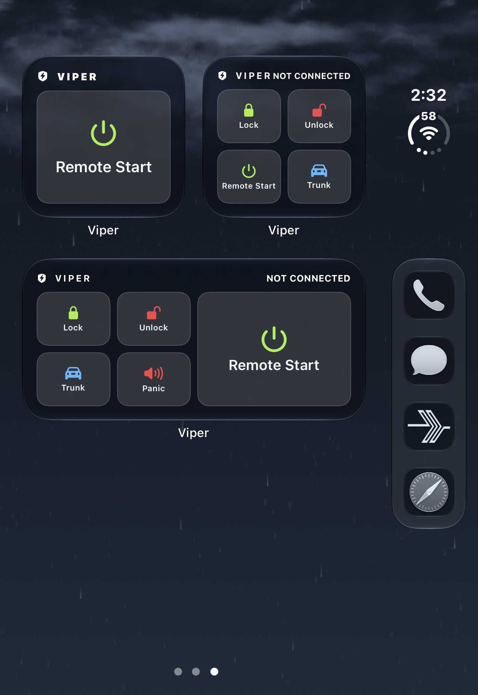
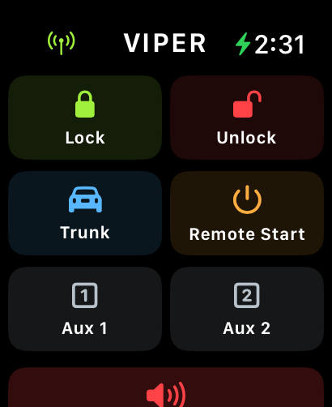

# WireSTART

**A Bluetooth remote for Viper VSM50BT built for iPhone Duo and Apple Watch Ultra.**

Viper is an independent iOS app for the Viper VSM50BT SmartStart accessory. It connects locally without a SmartStart account or cloud service, with a layout designed for the Duo’s cover and inside screens in portrait and landscape.

[Download the first release](https://github.com/wireproof/Viper/releases/tag/v1.0.0) · [Build from source](#build-and-install) · [What has been tested](#testing-and-limitations)

## Designed for iPhone Duo

| Cover screen | Inside screen |
|:---:|:---:|
|  |  |
|  |  |

Connect or disconnect the app’s accessory session, then send Lock, Unlock, Remote Start, Trunk, Aux 1, Aux 2, or Panic. Trunk, Remote Start, and Panic have confirmation steps. The original system pairing remains in iOS when Viper disconnects.

## Your remote, your style

Tap the Viper emblem to choose from nine black-leather icon designs. The black viper with green eyes is the default; there are color-accented and eyes-only alternatives. The clock control offers session-hold options from five minutes to twelve hours.

| Choose an icon | Session hold | Bluetooth details |
|:---:|:---:|:---:|
|  |  |  |

The session hold is an app setting: it does not change a demonstrated firmware timeout on the VSM50BT. iOS may suspend the app or disconnect the link, and retaining the app session can affect widget access.

## Widgets and Apple Watch Ultra

Interactive Home Screen widgets offer grouped controls and configurable single-command widgets; Lock Screen controls are also available. Widget commands attempt to use their own Bluetooth accessory session without opening Viper.

The Apple Watch Ultra companion sends requests through the paired iPhone. Its wireless indicator reflects iPhone reachability, flashes blue for a send, red for a delivery failure, and yellow when the iPhone forwards an observed accessory `ERR`. An indicator or acknowledgment is not confirmation of the vehicle’s physical state.

| Home Screen widgets | Apple Watch Ultra |
|:---:|:---:|
|  |  |

## Testing and limitations

The owner has physically verified Lock, Unlock, Trunk, and Remote Start in earlier Viper builds, and a Lock widget command operated the vehicle without opening the app. An Apple Watch command worked while the iPhone app was backgrounded in an earlier build; later background requests were intermittent. Aux 1, Aux 2, Panic, the newer widget designs, and long-duration background reliability need independent device testing.

In isolated tests, the module returned `LOCK OK` and `UNLOCK OK` in normal mode and `ERR` during valet-mode tests. An `ERR` can suggest valet mode but does not establish why the reply occurred or whether a vehicle command succeeded. Fob temperature, runtime remaining, and a Bluetooth equivalent of the fob’s Function key have not been established.

The screenshots were supplied by the project owner, who reports they show the current app at the time of capture. The 1.0.0 package was built afterward; screenshots illustrate the interface rather than independently verifying the package.

## Build and install

Viper is purpose-built around **iPhone Duo on iOS 27.2**, with an **Apple Watch Ultra** companion. The project was built with **Xcode 27.1 and the iOS 27.1 SDK**. The application targets iOS 16 or later, the widget requires iOS 17 or later, and the Watch companion targets watchOS 10 or later; those minimum versions are deployment targets, not a claim of testing on every device.

The release IPA is **unsigned**. Sign it with a suitable Apple development identity and provisioning profiles before installing, or open `ios/Viper.xcodeproj` in Xcode and select your development team. The project can be regenerated with `ios/make_project.py`.

```sh
cd ios
swiftc AccessoryReply.swift Tests/AccessoryReplyTests.swift -o /tmp/viper-reply-tests && /tmp/viper-reply-tests
swiftc ResponseFramer.swift Tests/ResponseFramerTests.swift -o /tmp/viper-framer-tests && /tmp/viper-framer-tests
swiftc WidgetConfirmation.swift Tests/WidgetConfirmationTests.swift -o /tmp/viper-widget-tests && /tmp/viper-widget-tests
```

Viper stores diagnostic events and responses locally. The original SmartStart app, decrypted binaries, provisioning profiles, and personal diagnostic logs are not included. Viper and SmartStart are marks of their respective owners; this independent project is not affiliated with them.
