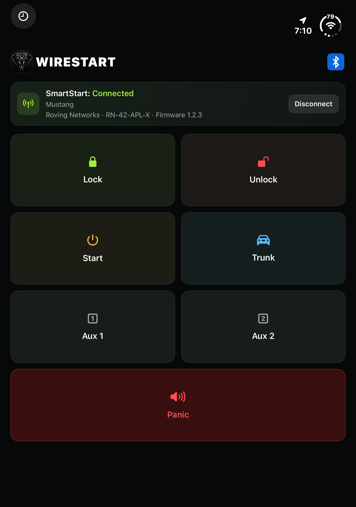
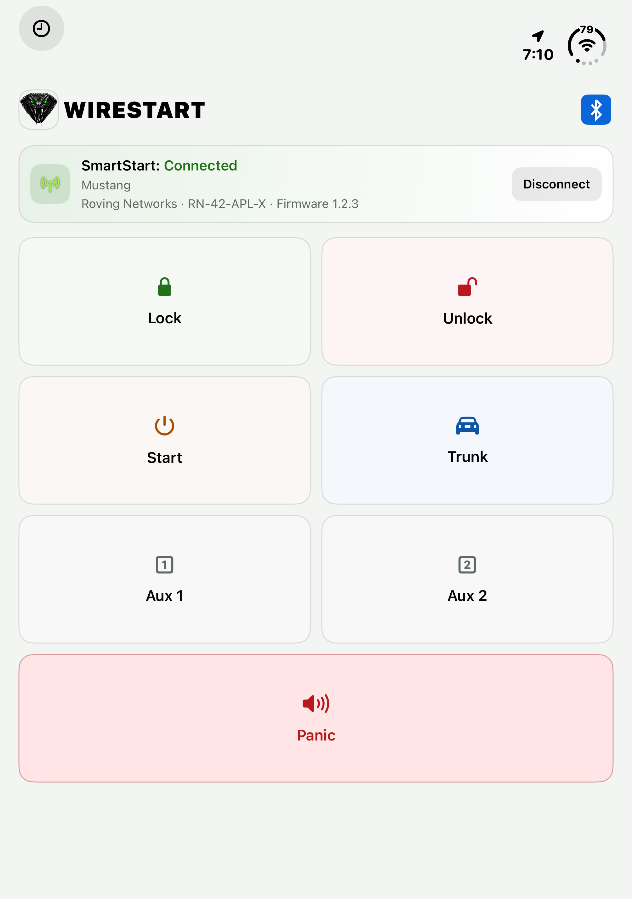
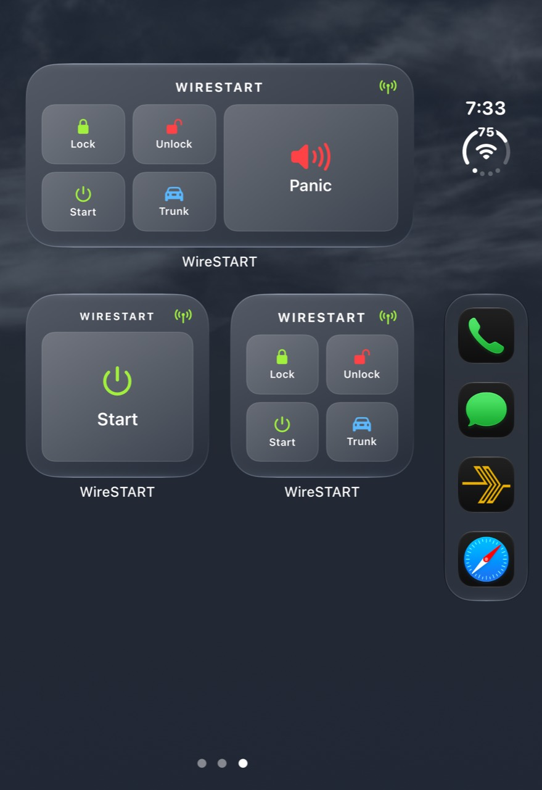
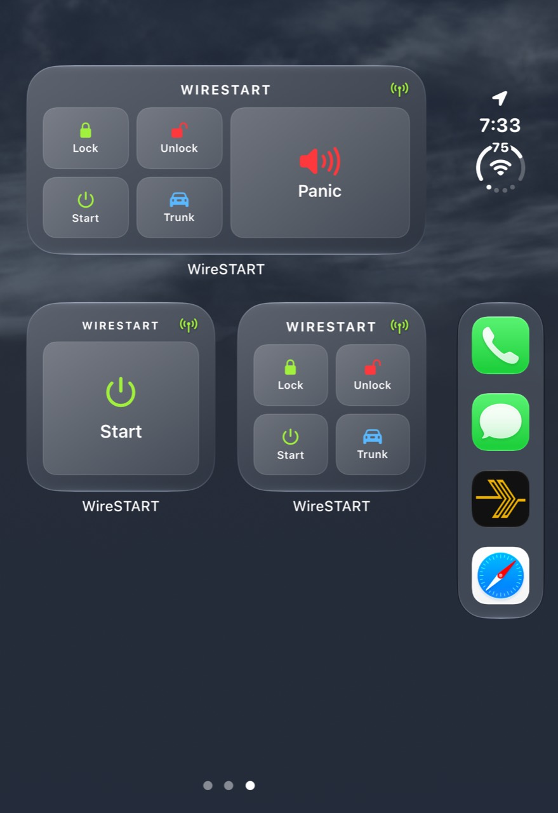

# WireSTART

**Your Viper VSM50BT remote, made for iPhone Duo and Apple Watch Ultra.**

WireSTART connects to your SmartStart module over Bluetooth, without a SmartStart account. Use it on your Duo’s cover or inside screen, from your Home Screen or Lock Screen, or from your Apple Watch.

[Download unsigned IPA](https://github.com/wireproof/WireSTART/releases/latest) · [Installation](#installation) · [Screenshots](docs/screenshots/README.md)

The download needs to be signed and installed with your own Apple development setup. It is not a direct App Store install.

## At a glance

- **Vehicle controls:** Lock, Unlock, Start, Trunk, Panic, and two optional auxiliary controls.
- **Made for iPhone Duo:** A layout that adapts to the cover and inside screens, in portrait and landscape.
- **Apple Watch Ultra:** Use the Watch app, individual complications, or a three-control Watch face complication.
- **Widgets:** Put controls on your Home Screen or Lock Screen, including individual commands and paired layouts.
- **Make it yours:** Pick from nine viper icons with white leather in light appearance and black leather in dark appearance, enable **Keep Icon Dark** to retain the dark icon in light appearance, and give each SmartStart module a vehicle name.
- **Siri and Shortcuts:** Ask Siri to lock or unlock, or use a shortcut to confirm Start, Trunk, or Panic.

## Made for iPhone Duo

| Connected | Disconnected |
|:---:|:---:|
|  |  |

| Inside screen · dark | Inside screen · light |
|:---:|:---:|
|  |  |

Choose a connection time with the clock button. The app, Watch, and widgets use the same setting when the app can process their activity. In Bluetooth settings you can give each module a name of up to 20 characters; names stay on your iPhone.

## Apple Watch Ultra

Use the Watch app when your paired iPhone is nearby. The wireless indicator shows connection status, and the Watch can show lock, unlock, and valet indicators reported by the accessory. Tap Connect when SmartStart is disconnected.

The Watch’s wireless indicator gives quick feedback:

- **Green:** The iPhone is reachable and SmartStart is connected.
- **Gray:** The iPhone is unreachable or SmartStart is disconnected.
- **Flashing blue:** A command or connection request is being sent.
- **Flashing red:** A request failed or the iPhone could not be reached.
- **Flashing yellow:** SmartStart reported an accessory error, shown as valet mode.

A flash reports communication activity, not proof that the vehicle completed a command.

Add individual command complications or choose a three-button rectangular layout. Tapping a complication opens WireSTART on the Watch; Start, Trunk, and Panic ask for confirmation. The complication can display the last reported status, but its updates may lag.

| Watch app | Watch face |
|:---:|:---:|
|  |  |

## Widgets

Choose a single command or a group of controls for your Home Screen. On the Lock Screen, use individual commands or pair Lock and Unlock, or Start and Trunk. Start, Trunk, and Panic ask for confirmation.

The Home Screen widgets adapt to dark, light, and clear appearances. The wide widget lets you choose its large button.

| Dark | Light | Clear |
|:---:|:---:|:---:|
|  |  |  |

Widgets reflect the most recent connection and command information available to them, which can take time to update. A Connect button appears when no SmartStart connection is known.

[See all screenshots](docs/screenshots/README.md), including the icon chooser and all three Watch complication layouts.

## Good to know

WireSTART is designed for the **Viper VSM50BT**. Available functions depend on your vehicle’s installation; Aux 1 and Aux 2 are optional. The Watch works through its paired iPhone, and iOS may pause background connections.

A status can show that a command was sent or acknowledged. Check your vehicle to confirm the result. WireSTART is an independent project and is not affiliated with Viper or SmartStart; those names belong to their respective owners.

## Installation

1. Download the [latest unsigned IPA](https://github.com/wireproof/WireSTART/releases/latest).
2. Sign and sideload it with your own Apple development setup, or open `ios/WireSTART.xcodeproj` in Xcode, select your development team, and build for your iPhone.
3. Pair your VSM50BT with your iPhone, open WireSTART, and connect. Install the companion app on your paired Apple Watch to use Watch controls.

The project is designed for iPhone Duo on iOS 27.2 and Apple Watch Ultra, and built with Xcode 27.1 and the iOS 27.1 SDK. The app’s bundle identifier is `com.wireproof.wirestart`.

## License

WireSTART is available under the [MIT License](LICENSE).
