# WireSTART

**A Bluetooth remote for Viper VSM50BT built for iPhone Duo and Apple Watch Ultra.**

Control your vehicle from your iPhone without a SmartStart account. WireSTART connects locally over Bluetooth and is designed to feel at home on both the Duo’s cover and inside screens.

[Download WireSTART](https://github.com/wireproof/WireSTART/releases/latest) · [Build and install](#build-and-install)

## Made for iPhone Duo

Whether your Duo is open or closed, WireSTART puts your controls within reach. Its layout adapts to portrait and landscape on both displays.

| Cover screen | Inside screen |
|:---:|:---:|
| 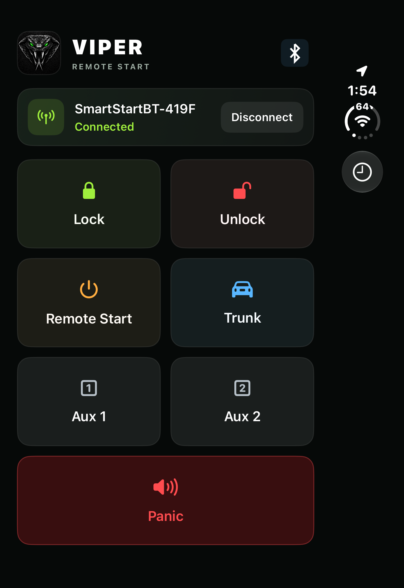 | 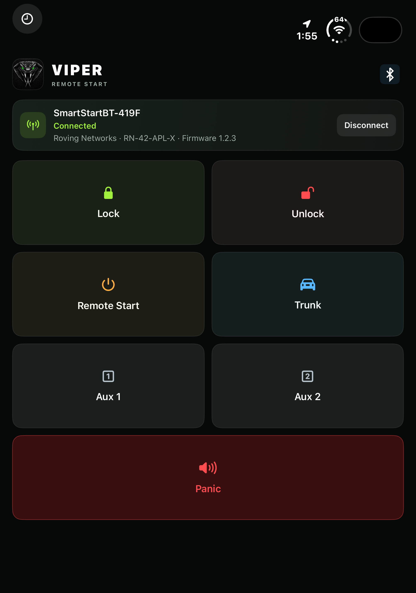 |
| 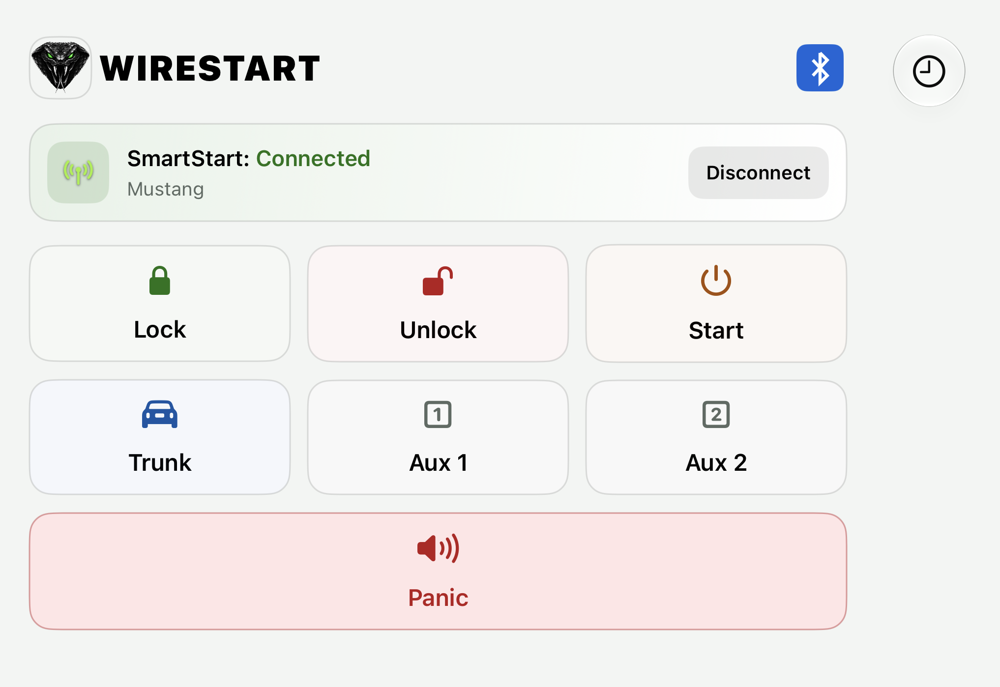 | 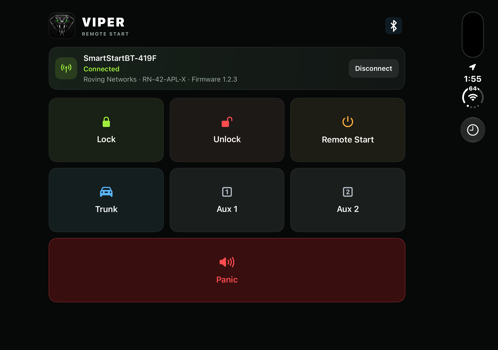 |

### Your controls

Lock, unlock, remote start, release the trunk, activate Aux 1 or Aux 2, and use Panic—all from one screen. Trunk, Remote Start, and Panic ask for confirmation before sending.

The Connect and Disconnect button controls WireSTART’s session. Disconnecting the app does not remove your iPhone’s Bluetooth pairing.

## Make it yours

Tap the app icon in the upper-left corner to choose from nine viper designs. The black viper with green eyes is the default, with other colors and eye-only designs available.

The clock lets you choose how long WireSTART tries to keep its connection ready after activity, with a 15-minute minimum. Watch commands and widget activity use the same setting when the app can process them. Open Bluetooth details to name each SmartStart module and see its accessory information. Vehicle names stay on this iPhone and can be up to 20 characters.

| Choose an icon | Connection options | Bluetooth details |
|:---:|:---:|:---:|
| 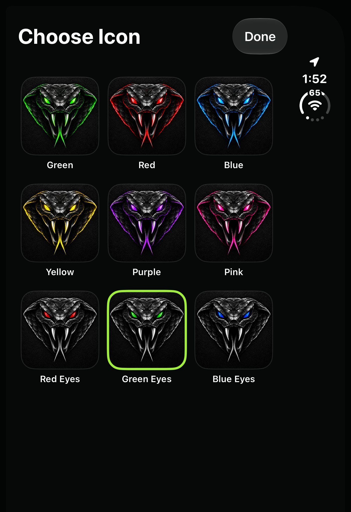 | 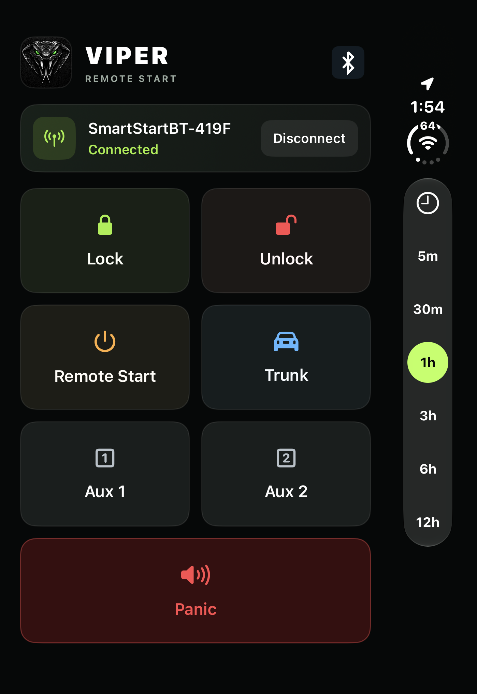 | 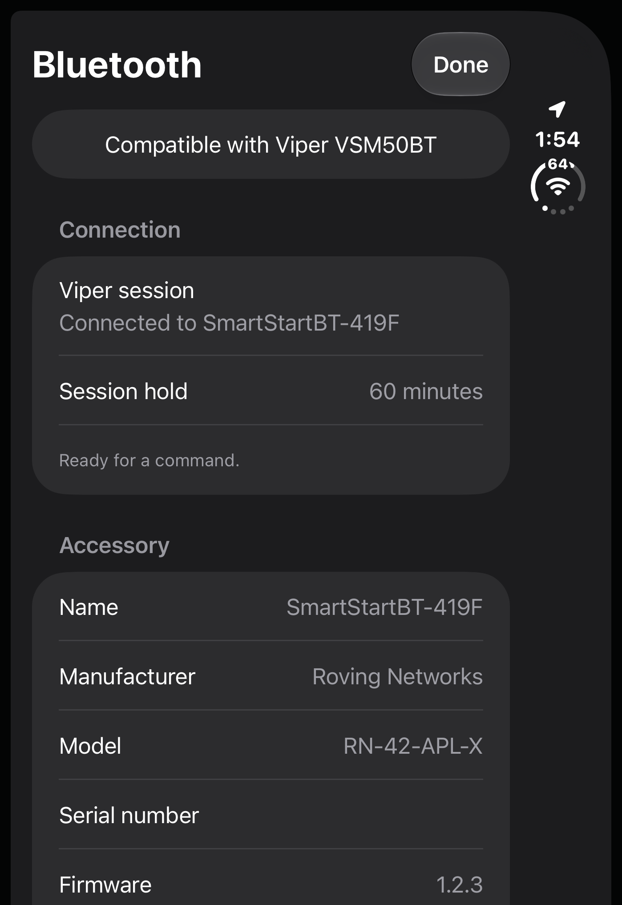 |

## Widgets and Apple Watch Ultra

Add a grouped remote or individual command widgets to your Home Screen. Lock and Unlock are also available as Lock Screen controls. Widgets can send commands without opening the app. The wireless icon reflects the app’s last reported SmartStart session or a recent widget response; widgets dim their controls when no connection is known. Widget updates may lag behind changes in the app. A Connect button appears when no connection is known. After a command from the app or widget, short status labels show recognized accessory replies or an unconfirmed result.

Use the Apple Watch Ultra companion when your paired iPhone is nearby. When disconnected, tap Connect to ask the iPhone to connect to an available SmartStart. Add individual command complications or choose a three-button rectangular layout for a supported watch face. Tapping a complication opens WireSTART on the Watch to send the command; Remote Start, Trunk, and Panic ask for confirmation. Its wireless indicator shows whether the iPhone is reachable and flashes when a command is sent or encounters a problem. When both apps are reachable, iPhone command flashes and recognized lock, unlock, and valet indicators are shared with the Watch.

| Apple Watch Ultra | Home Screen widgets |
|:---:|:---:|
| 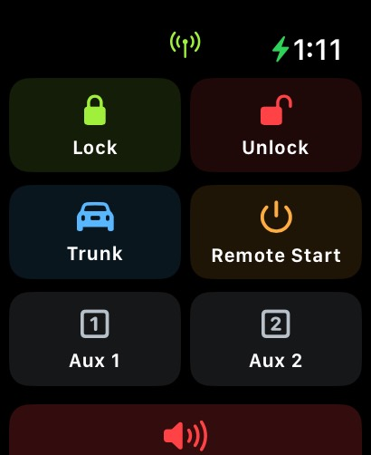 | 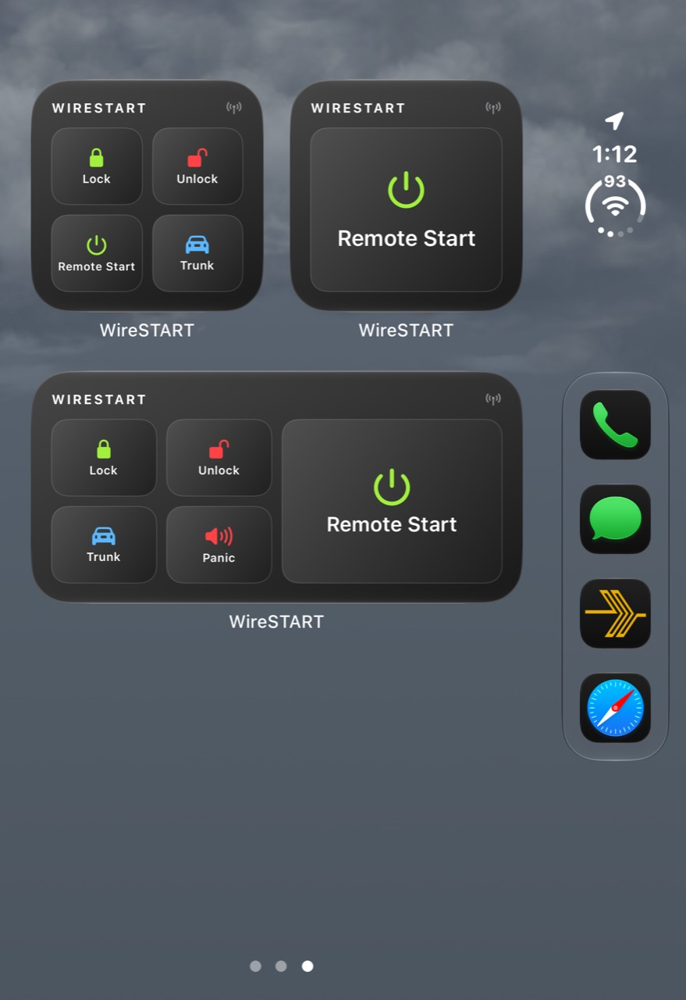 |

Widgets adapt to your Home Screen appearance:

| Light | Tinted | Clear |
|:---:|:---:|:---:|
| 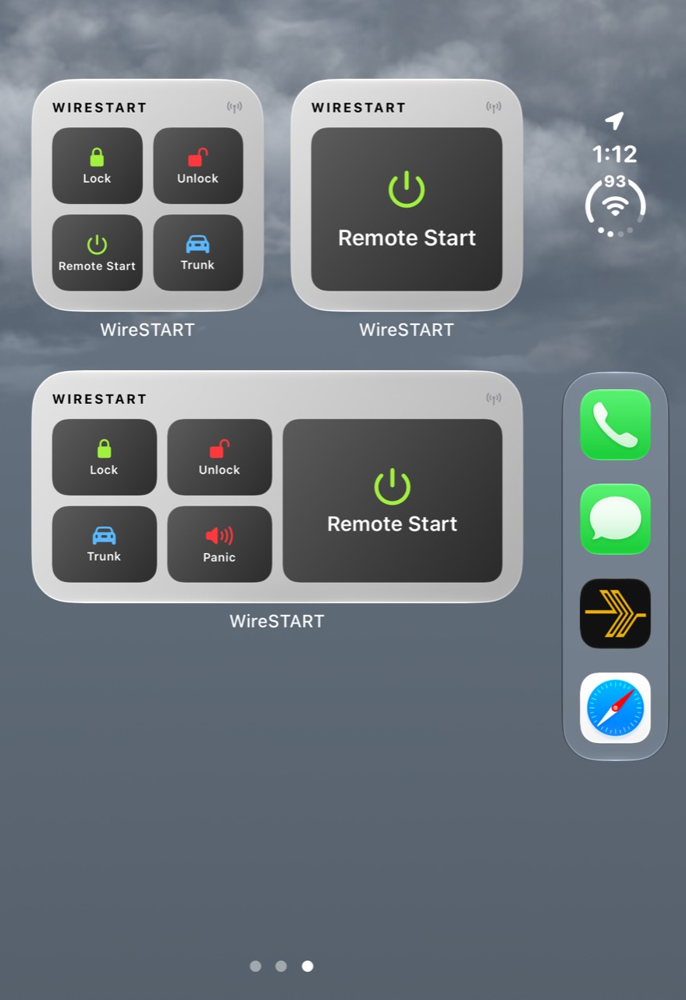 | 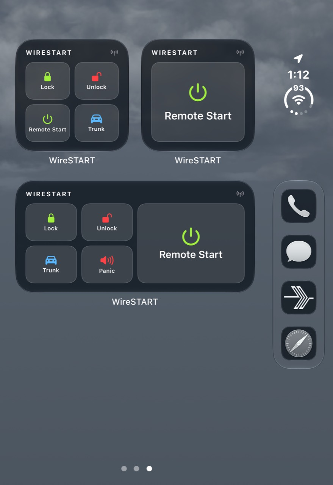 | 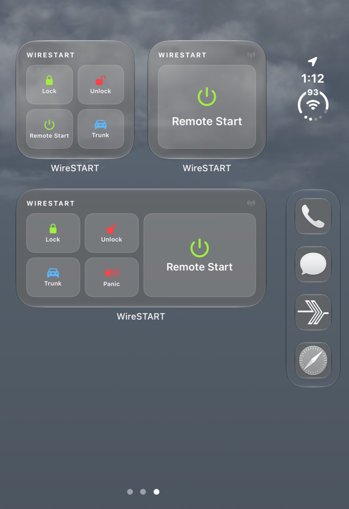 |

## Siri and Shortcuts

Use WireSTART shortcuts to lock or unlock, or ask Siri to send Remote Start, Trunk, or Panic after confirmation. Shortcuts report when a command is sent; check the vehicle for the result. Your SmartStart connection needs to be available.

## Good to know

WireSTART communicates through a Viper VSM50BT accessory. Available functions depend on your vehicle’s installation. A message or indicator can show that a command was sent or acknowledged, but check your vehicle to confirm what happened.

The Watch needs its paired iPhone, and iOS can pause background connections. Keeping WireSTART’s session open can also affect widget access. Temperature and remaining runtime are not currently displayed.

Screenshots were supplied by the project owner. Some show the app before its rename from Viper to WireSTART.

## Build and install

WireSTART is designed for **iPhone Duo on iOS 27.2** and **Apple Watch Ultra**, and built with **Xcode 27.1 and the iOS 27.1 SDK**. The app uses the bundle identifier `com.wireproof.wirestart`. If you used an earlier build, iOS treats this as a separate app; reconnect the accessory and add its widgets again. The release IPA is unsigned and needs to be signed before installation. You can also open `ios/WireSTART.xcodeproj` in Xcode and select your development team.

WireSTART is an independent project and is not affiliated with Viper or SmartStart. Viper and SmartStart are marks of their respective owners.
