# WireSTART screenshots

[Back to WireSTART](../../README.md)

A closer look at the iPhone Duo app, widgets, and Apple Watch Ultra companion.

## iPhone Duo cover screen

| Dark · connected | Dark · disconnected | Light · connected |
|:---:|:---:|:---:|
|  |  | 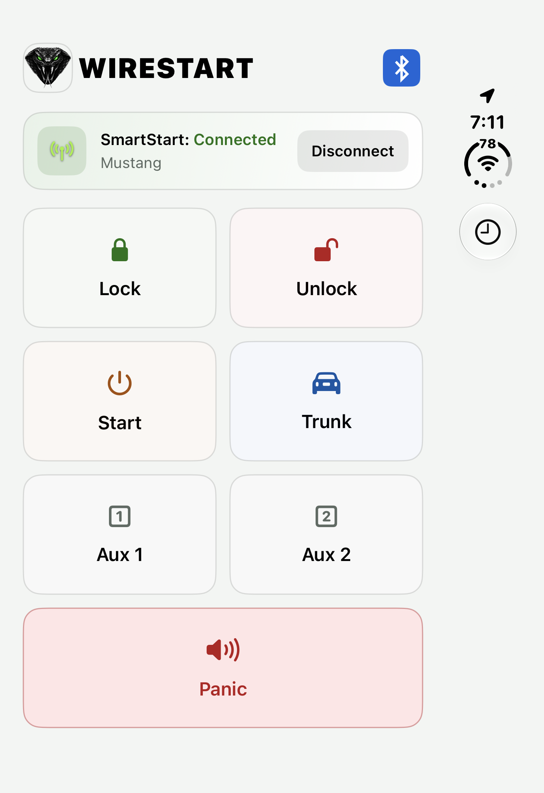 |

| Landscape · light | Bluetooth details |
|:---:|:---:|
|  |  |

## iPhone Duo inside screen

| Dark | Light |
|:---:|:---:|
|  |  |

| Landscape · dark | Landscape · light |
|:---:|:---:|
| 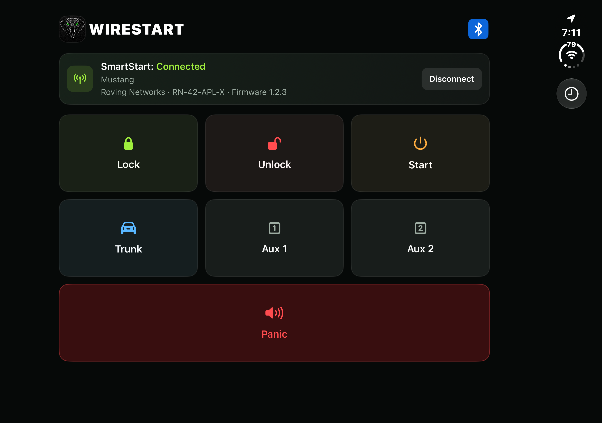 | 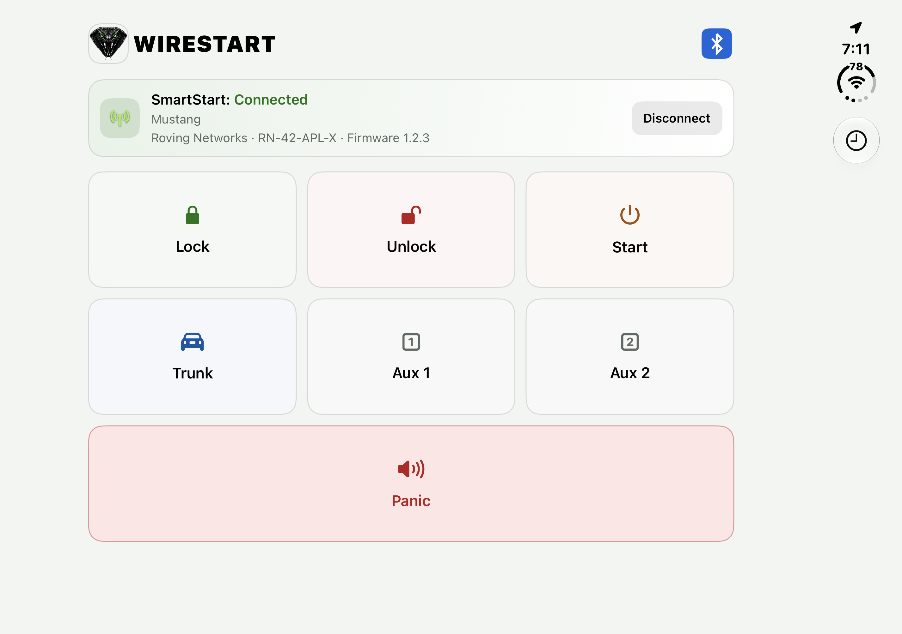 |

| Session controls · dark | Session controls · light | Choose an icon |
|:---:|:---:|:---:|
| 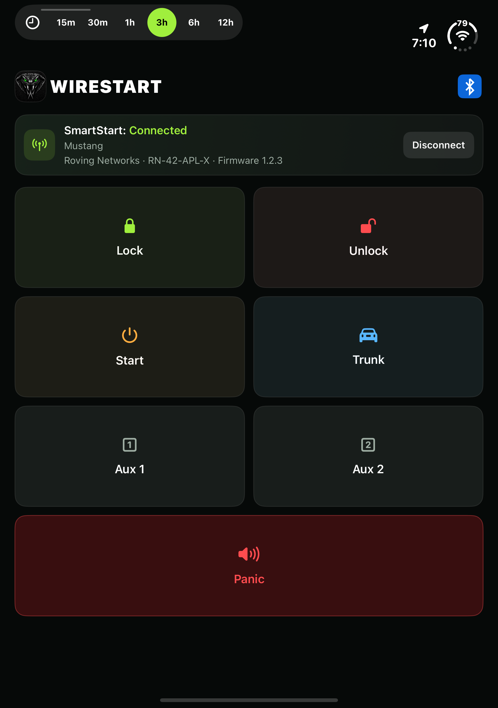 | 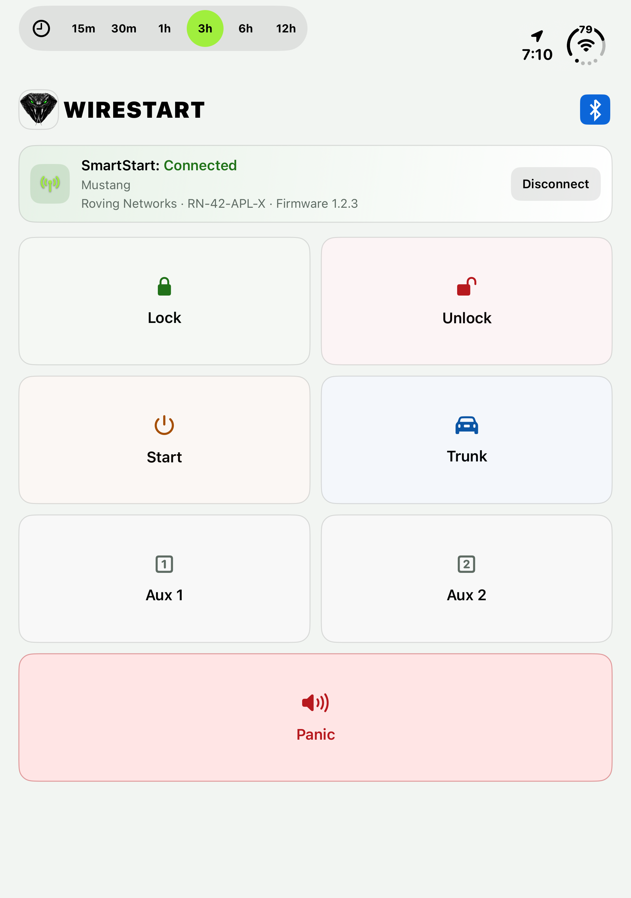 | 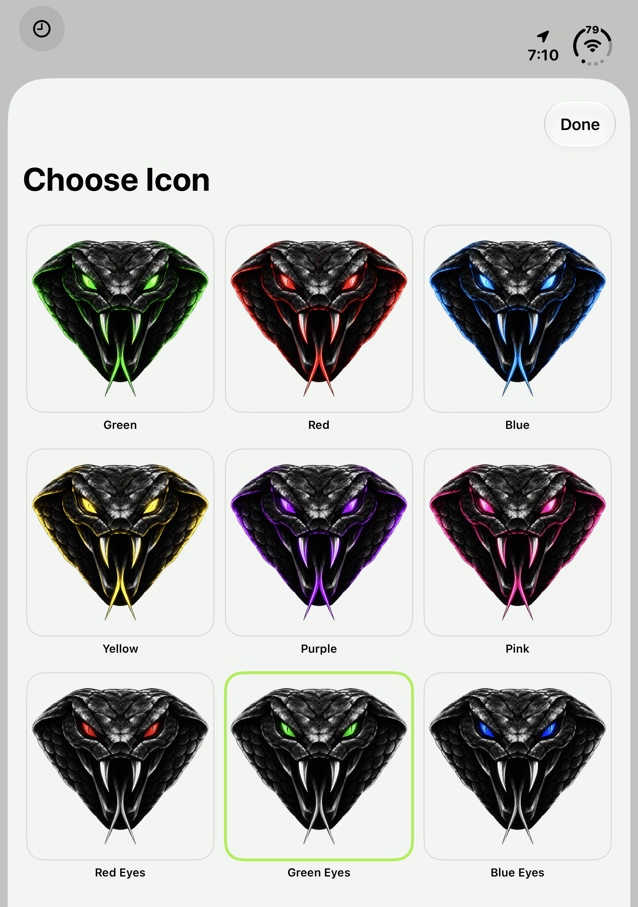 |

## Choose your icon

| Dark mode | Light mode |
|:---:|:---:|
| 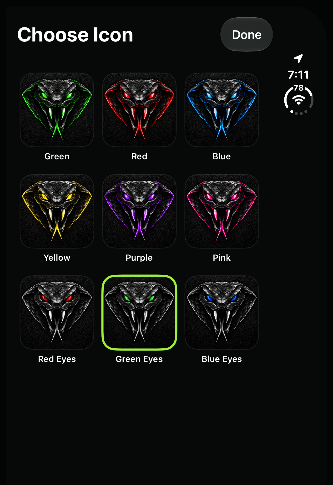 | 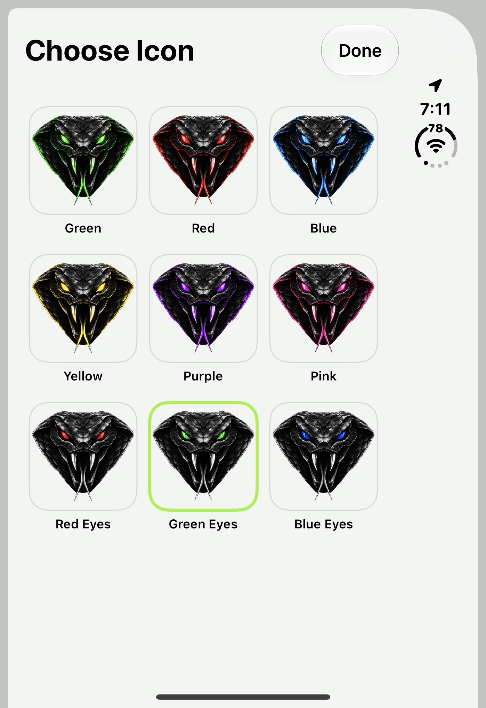 |

## Home Screen widgets

| Dark | Clear |
|:---:|:---:|
| 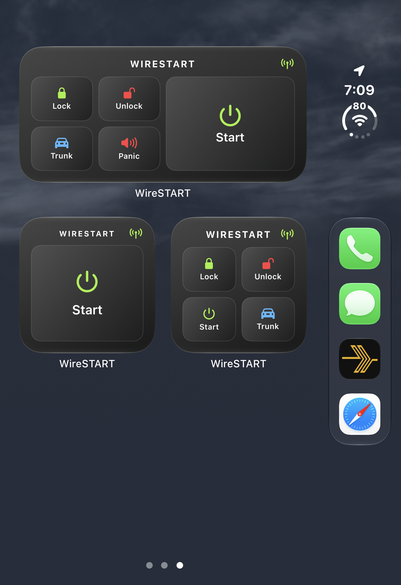 | 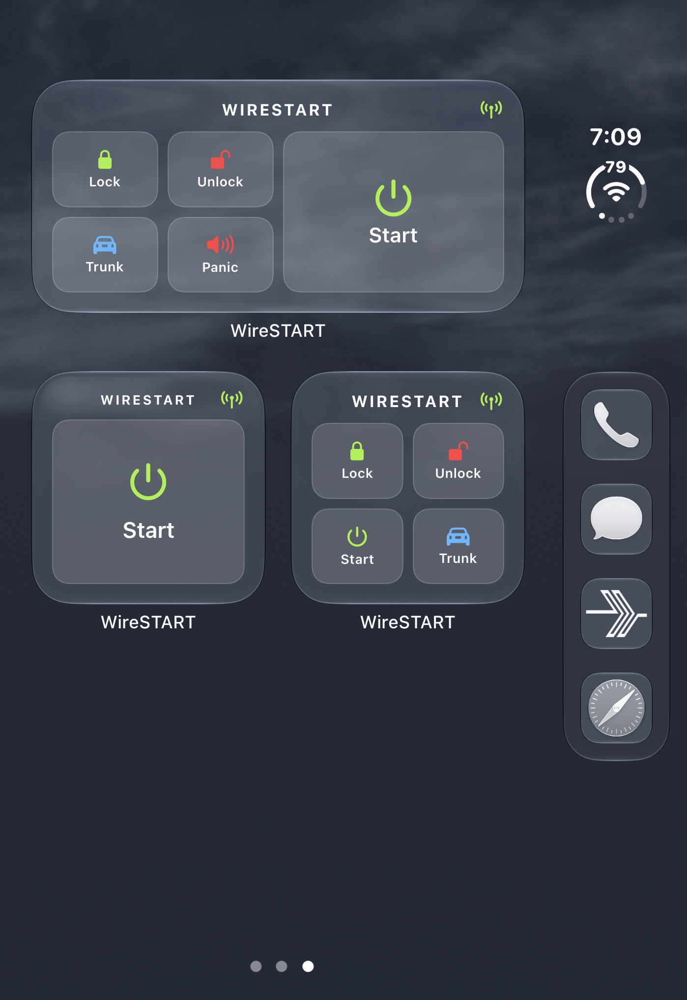 |

## Lock Screen widgets

| Lock, Unlock, Start, Trunk | Lock, Unlock, Start, Panic |
|:---:|:---:|
| 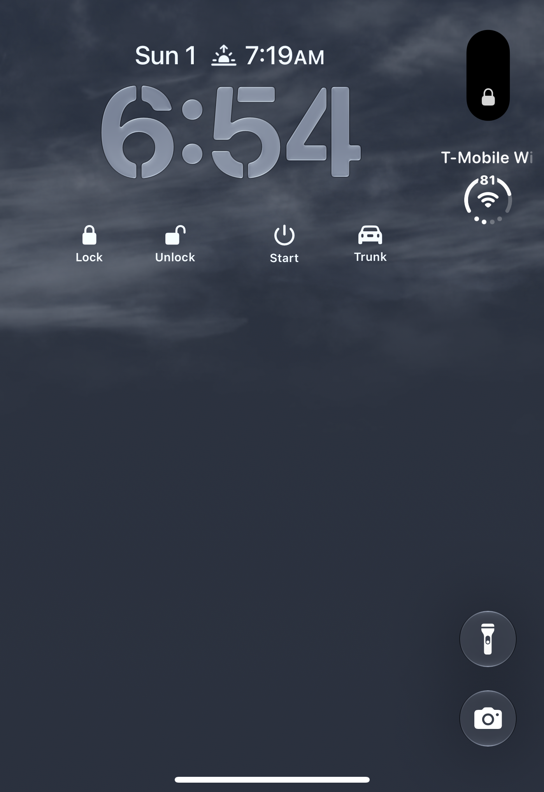 |  |

## Apple Watch Ultra

| Connected | Connect |
|:---:|:---:|
|  |  |

| Lock, Unlock, Start | Lock, Unlock, Trunk | Start, Trunk, Panic |
|:---:|:---:|:---:|
|  | 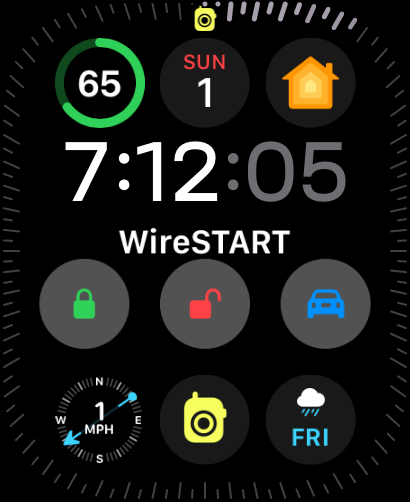 | 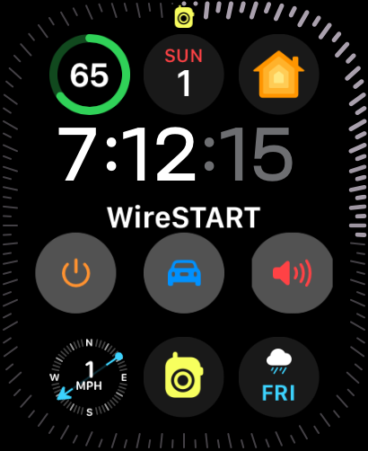 |
